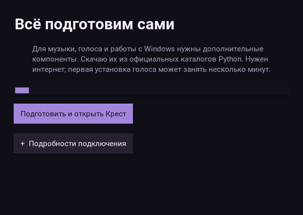
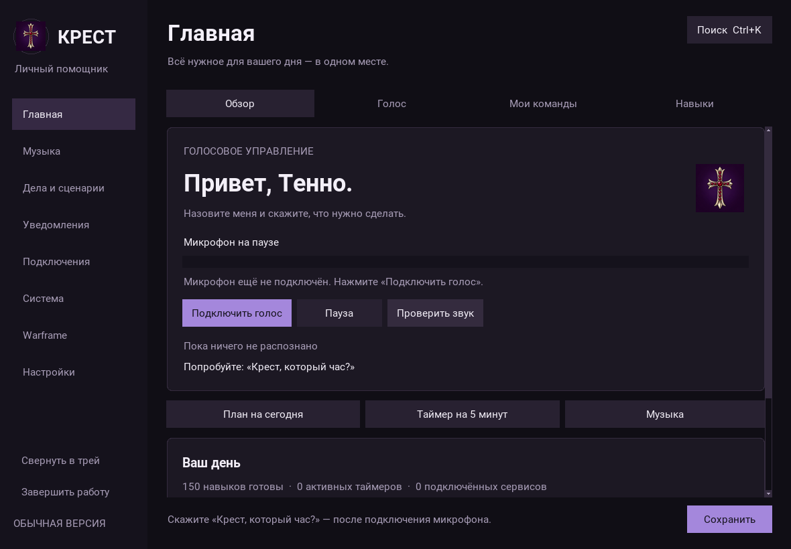

# Запуск без PowerShell-команд

## Пользователю

1. Завершите старую Крест через меню, затем обновите исходники. Сохраните свои модели и данные.
2. Откройте **start.bat** двойным щелчком из распакованной папки проекта.
3. При первом запуске нажмите **«Подготовить и открыть Крест»**. Подготовка идёт в фоне,
   с индикатором и сообщением об ошибке, если пропал интернет. Команды копировать не нужно.
4. Дождитесь открытия меню. Дальше используйте тот же `start.bat`: если компоненты готовы,
   установка не повторяется и подключение к интернету для проверки пакетов не нужно.

Если подходящего Python нет, появится предложение установить его автоматически.
Помощник скачивает Windows x64 Python 3.12.10 с python.org, проверяет действительную
цифровую подпись Python Software Foundation и устанавливает среду для текущего
пользователя, без изменения системного PATH. При отказе или ошибке файл не запускается.
Корпоративные ограничения установки и сетевые блокировки автоматически не обходятся.

В уже работающем меню есть **Музыка → Подключить управление музыкой**.
Нажмите кнопку, затем **«Подключить музыку»** в окне подготовки. После завершения
нажмите **«Обновить трек»** и запустите воспроизведение в Яндекс Музыке или другом
плеере. Подключение компонентов не гарантирует поддержку всех кнопок любым плеером:
лайки по-прежнему зависят от доступных элементов его интерфейса.

Модели Vosk и Silero, настройки и пользовательские записи не удаляются и не заменяются.
Устанавливаются программные библиотеки; ваши модели по-прежнему берутся из папки проекта.
Первая установка голоса может быть долгой из-за размера PyTorch. Используется CPU-вариант,
скачивание CUDA-комплекта не требуется. Во время установки окно можно закрыть с
подтверждением прерывания; при следующем запуске готовность будет проверена заново.

## Шрифт

В меню используется **Roboto Regular / Bold** с кириллицей. Оба файла включены
в исходники вместе с лицензией Apache 2.0. Windows регистрирует их только для
процесса Крест — устанавливать шрифт вручную или менять системные шрифты не нужно.
Общий шрифт используется в полях, списках, кнопках, заголовках, диалогах и окне
подготовки. Технический журнал сохраняет моноширинное оформление.

## Что исправлено в музыке

Неверный импорт `winsdk.media.control` заменён на действительный
`winsdk.windows.media.control`. Из-за прежнего пути сообщение об отсутствующих
компонентах могло появляться даже после правильной установки пакета.

`requirements-media.txt` содержит только компоненты медиасессий, громкости и UI
Automation. Кнопка меню не устанавливает заново голос и ботов. Запущенное ядро
через аутентифицированный локальный API сообщает свой интерпретатор: пакеты
устанавливаются именно в эту среду, а не в случайный Python из PATH.

## Проверки и ограничения

`setup_app.py` использует Tk и стандартную библиотеку, поэтому может открыться
до установки зависимостей самой Крест. Скрипты подготовки создают `.venv`;
если прежняя среда несовместима, используют `.krest-runtime`, сохраняя старую папку.
Две несовместимые существующие среды требуют отдельной диагностики и не затираются.
Проверяются версии пакетов и наличие модулей; Windows-модуль медиасессий дополнительно
импортируется. Установка использует фиксированные манифесты проекта, PyPI и
официальный CPU-каталог PyTorch. Одновременные установки блокируются локальным замком.
Повреждённые пакеты можно повторно установить кнопкой; журнал доступен в раскрываемых
подробностях. Сборки EXE Крест в этом обновлении нет — это запуск исходников.

В Linux проверены интерфейс подготовки, обработка ошибок/повтор, выбор интерпретатора,
команды установки, отсутствие повторной установки готовой среды, API ядра и регистрация
шрифта. Скачивание/установка Python и реальное управление Яндекс Музыкой на Windows
здесь не запускались. В Windows CI добавлены установка медиакомпонентов, проверка
настоящего импорта WinSDK и синтаксиса PowerShell; результат CI следует смотреть отдельно.

