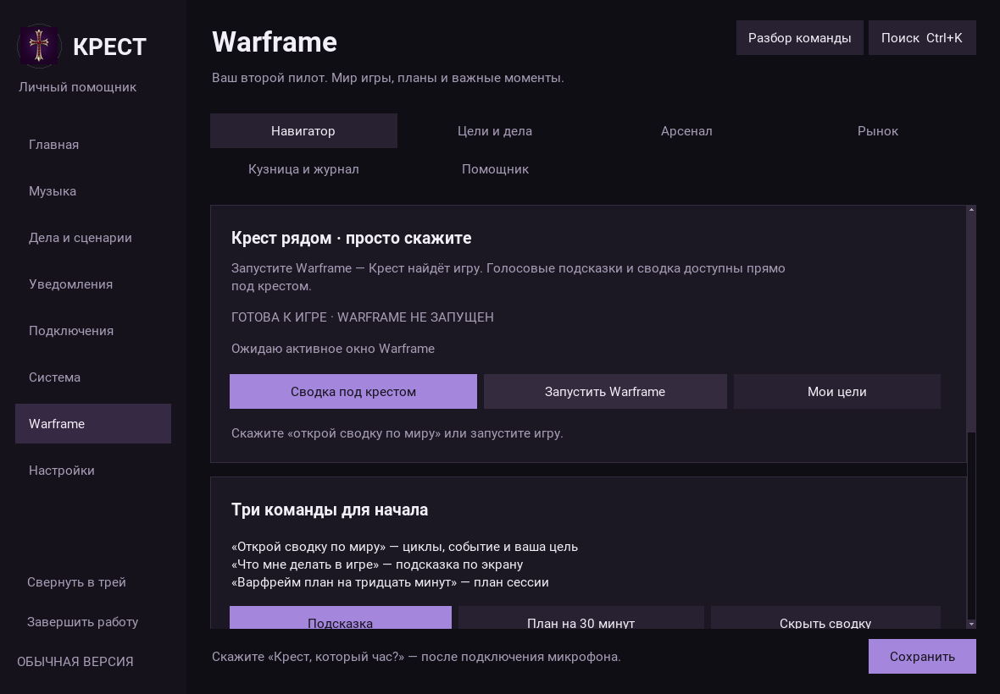
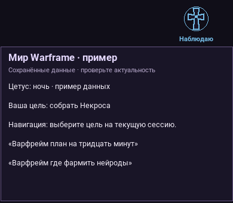
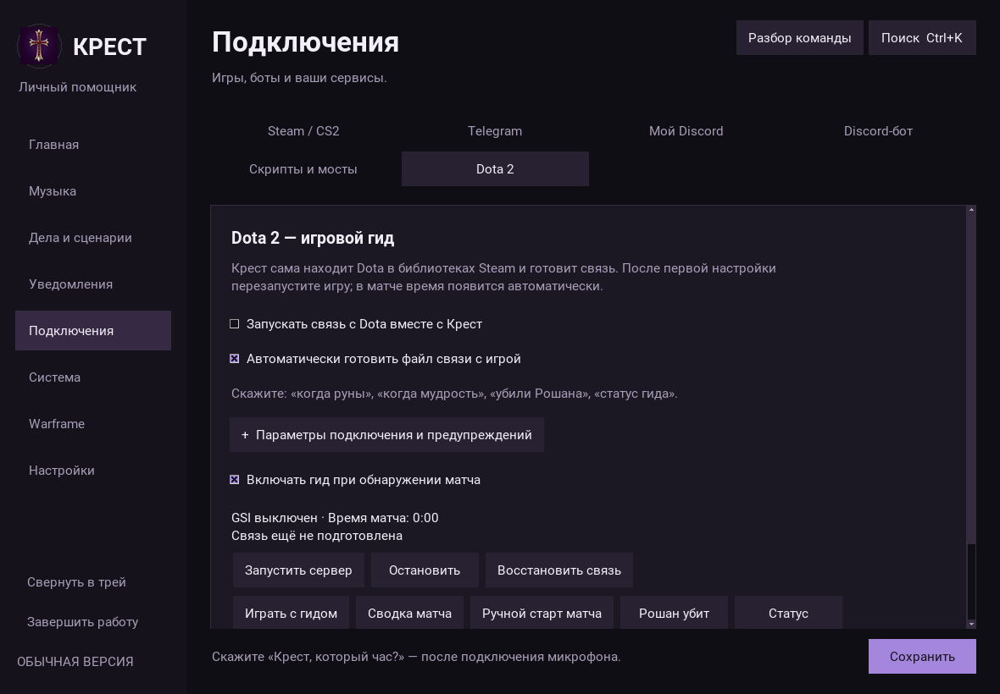
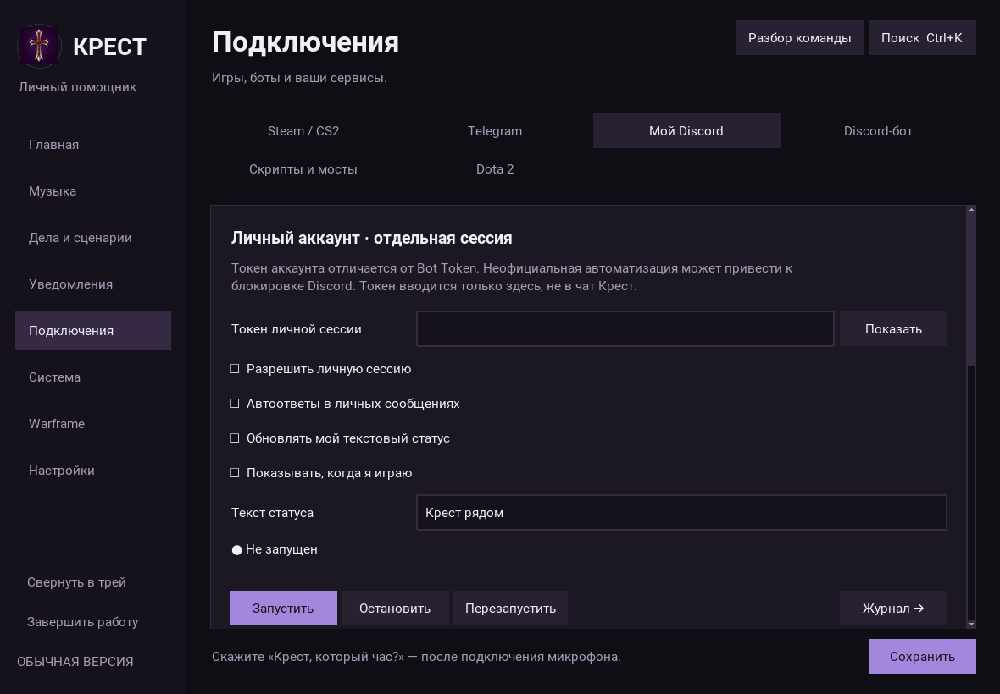
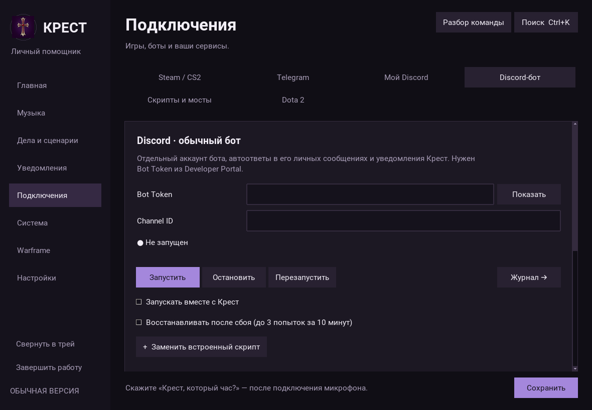

# Игровые гиды и боты: обновление 11 октября 2026

## Warframe без таблиц на первом экране

Навигатор начинается с состояния подключения, трёх голосовых команд и быстрых
действий. Циклы и таблицы событий находятся в раскрывающемся разделе. Вкладки
создаются по требованию. Личные цели, кузница, рынок и арсенал сохранены.

Во время игры скажите:

- **«Крест, открой сводку по миру»** — карточка под крестом на 90 секунд: до трёх
  циклов, одно событие, ваша первая незавершённая цель и подсказка по экрану.
- **«Крест, скрой сводку»** — свернуть карточку.
- **«Крест, что мне делать в игре»** — контекстная подсказка.
- **«Крест, варфрейм план на тридцать минут»** — план по вашим целям.
- **«Крест, варфрейм где фармить нейроды»** — справочник ресурсов.

Карточка не перехватывает мышь и фокус, не требует прокрутки и скрывается при уходе
из активного окна игры. Для отображения поверх игры используйте оконный режим без
рамки; эксклюзивный полноэкранный режим Windows может скрывать обычные окна поверх игры.
Если сеть недоступна, карточка показывает личную цель и явно отмечает отсутствие
подтверждённых данных мира. Полная информация остаётся в меню.

OCR по-прежнему работает раз в 15 секунд, без новой нейросети. После двух совпадающих
наблюдений знакомого экрана Крест может показать короткую подсказку на 12 секунд:
награда реликвии, кузница, арсенал, навигация, успех или провал миссии. Снимки и чат
не сохраняются. На Windows 10 2004+ окно индикатора исключается из захвата экрана,
чтобы OCR не читал собственные подсказки. Подсказки основаны на распознанных надписях;
состав награды, противники и движения персонажа пока не определяются.

## Контролируемый маршрут — эксперимент

В «Warframe → Помощник» включите экспериментальные маршруты. По умолчанию они
выключены. Автоматизация игры может нарушать её правила; это не готовый AFK-фармер.

1. В активном окне игры скажите **«запиши маршрут варфрейм»**. Записываются только
   W/A/S/D, пробел, Shift и Ctrl, максимум 60 секунд. Мышь, атаки и произвольные
   нажатия не записываются.
2. Скажите **«сохрани маршрут»** или нажмите F8. Движение сохраняется локально в
   `warframe_route.json`, в каталоге данных Крест.
3. Вернитесь в исходную точку. Скажите **«я отойду от игры»**, затем в течение
   20 секунд **«подтверждаю маршрут»**. Выполняется один повтор.
4. **Esc, F8, движение мыши, уход из окна игры или «верни управление»** останавливают
   повтор. Крест отпускает нажатые ею клавиши; голосовая остановка освобождает их
   при поступлении команды, не ожидая завершения другого сетевого запроса.

Золотой крест и карточка показывают запись/повтор. Это воспроизведение короткой
последовательности клавиш из текущего положения. Оно не распознаёт препятствия,
не корректирует маршрут, не ведёт бой и не обучается игре по видео. Реакцию
Warframe на синтетические нажатия и возврат управления нужно проверять в игре.

## Dota: автоматическая подготовка связи

Новый профиль включает запуск GSI вместе с ядром и автоматическую подготовку файла.
Ранее сохранённое выключение пользователем не переопределяется: включите
переключатели на странице Dota и сохраните настройки либо нажмите **«Играть с гидом»**.

Крест находит игру по Steam-манифесту, включая дополнительные библиотеки, создаёт
`game/dota/cfg/gamestate_integration/gamestate_integration_krest.cfg` и слушает только
локальный порт. Свой изменённый файл перед заменой сохраняет в `.cfg.bak`; чужие
конфиги интеграций не меняются. При отсутствии игры поиск повторяется раз в минуту.

**«Запусти доту с гидом»** открывает игру через Steam с `-gamestateintegration`.
После первого создания конфига уже запущенную игру требуется перезапустить.
Меню показывает отдельно работу сервера, подготовку файла и свежесть телеметрии.

**«Сводка матча»** сообщает здоровье, ману, счёт и золото из GSI. Данные старше
15 секунд не выдаются за текущие. Сохранились команды рун, мудрости, Рошана и
ручного старта. Тайминги событий не обновлялись по патчу игры: их актуальность
нужно сверить с установленной версией Dota.

## Discord и автоответы

«Мой Discord» теперь содержит отдельную личную сессию (`discord_account.py`) и
прежний Rich Presence. Обычный бот остаётся на своей странице (`ds_session.py`).
Токен аккаунта и Bot Token не смешиваются. В личной сессии отдельно включаются
подключение, автоответы, изменение custom status и отображение игровой активности.

Личная сессия использует неофициальные для автоматизации аккаунта HTTP/Gateway
интерфейсы Discord. Discord запрещает self-bots, возможна блокировка; успешный
вход конкретного аккаунта не гарантирован и в облачных тестах не проверялся.
Обход CAPTCHA, ограничений и извлечение токенов не реализованы. Токен вводится
в локальном меню, хранится через существующее хранилище учётных данных Windows,
маскируется в журнале и исключается из переносимой резервной копии.

Личная сессия отвечает только в индивидуальных личных чатах, пропускает ботов и
серверы, проверяет тип неизвестного канала. После исходящего сообщения пользователя
выдерживает паузу. Переподключения и очередь ограничены; обработка сообщений не
блокирует heartbeat шлюза. Telegram и обычный Discord-бот используют общий стиль:

- `minimal` — короткий ответ;
- `warm` — тёплая Крест;
- `gothic` — крест и тёмная эстетика;
- `tactical` — оформление бортового помощника.

Есть предпросмотр, интервал ответа одному контакту, срок удаления (0 — сохранять)
и отдельное согласие раскрывать игровую/рабочую активность. «Срочно» сокращает
паузу, но не позволяет отвечать без ограничения. Тексты не обещают доставку или
прочтение, которые программа не может подтвердить.

## Проверки и ограничения выпуска

Локальные проверки: **348 тестов прошли, 3 Windows-проверки пропущены**; загрузка каталога из 168 команд, Ruff,
меню в Linux/Xvfb, сводка без сети, запись/повтор с имитацией ввода и проверкой
отпускания клавиш, автоматическая подготовка Dota в дополнительной библиотеке Steam,
обработка сообщений Discord на тестовых данных без отправки сообщений.

[Проверки исходников Windows и Linux](https://github.com/KatoWolf/krest/actions/runs/38139419285)
успешны для программных изменений в коммите `e3bfbd2`.

Настоящие Discord-авторизация, Dota GSI из живого матча, Warframe OCR и ввод в игру
требуют Windows и пользовательских аккаунтов. Они не объявляются проверенными
по результатам тестовых данных. Автономный бой и обучение движениям по видео
не реализованы.

Предыдущая Windows-сборка установщика `38095722172` была остановлена GitHub по
лимиту 2 часа, без EXE-артефакта. Этот отчёт описывает исходники. Наличие сценария
сборки не означает готовый установщик.
