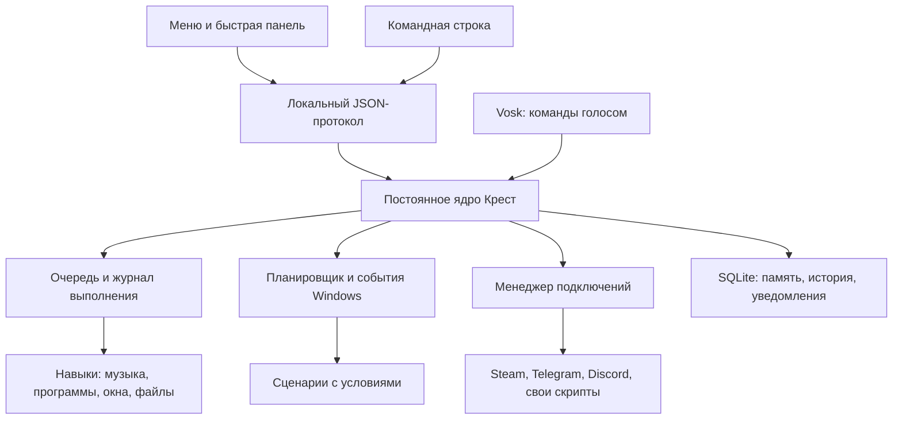
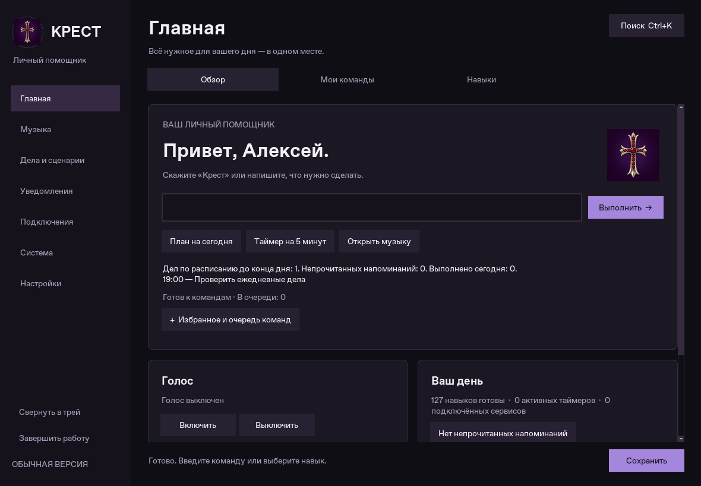
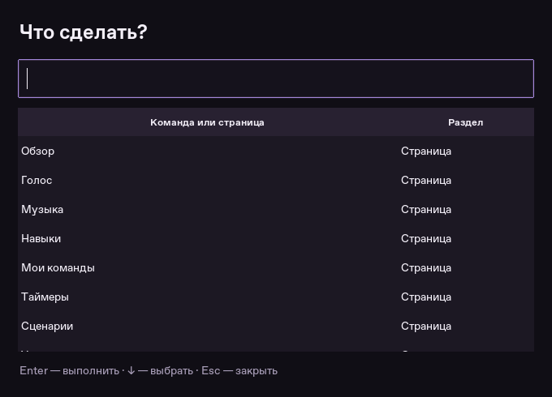
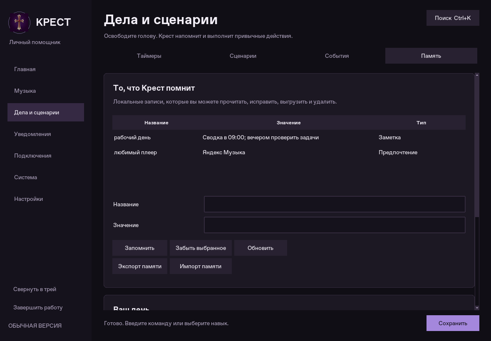
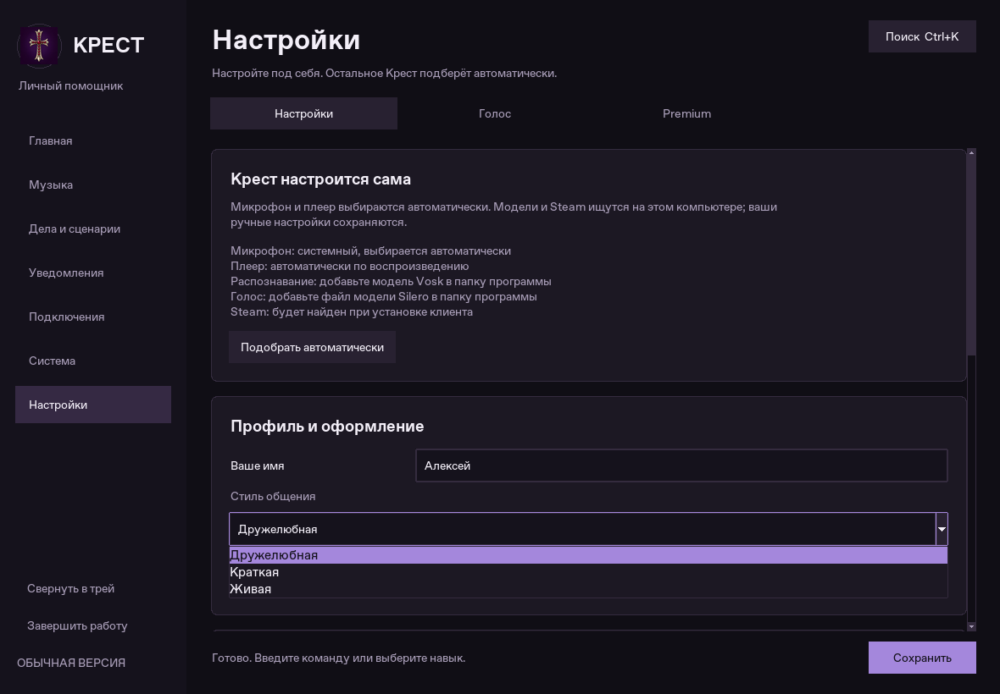
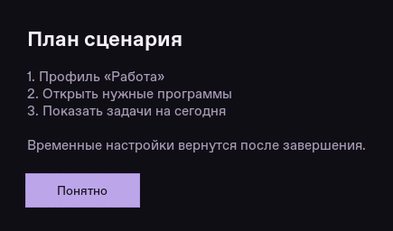

# Крест: отчёт о развитии 12 направлений

Дата: 10 октября 2026. Исходная опубликованная версия: `fd8f659`.

В этом изменении Крест получила постоянный процесс, общее хранилище результатов,
память, событийные сценарии и переработанное управление через меню. Все изменения
остаются Python-исходниками. Vosk и Silero сохранены; генеративная модель не добавлена.

У всех 12 направлений есть реализация и проверки в исходниках. Это готовая версия
для проверки на компьютере владельца; статус «всё проверено на Windows и реальных
аккаунтах» ей пока присваивать нельзя. Соответствующая приёмка приведена ниже.

## 1. Постоянное ядро

- `main.py` запускает отдельный процесс `kernel_service.py` и подключает меню к нему.
- Закрытие интерфейса и работа планировщика разделены. Таймеры, события и подключённые
  сервисы могут работать, когда окно закрыто или свёрнуто.
- Два запуска с одним конфигом подключаются к одному ядру; второй экземпляр меню
  поднимает существующее окно. Есть отдельная блокировка для ядра и для окна.
- Связь идёт через JSON и аутентификацию на `127.0.0.1`. Доступные операции перечислены
  явно, размер запросов, число обслуживающих потоков и время чтения ограничены.
- Трей принадлежит ядру. Из него можно открыть меню, быструю панель, отключить голос
  и завершить работу. Если трей не запустился, меню сообщает об этом и не скрывается
  в недоступный значок.
- `--status`, `--stop-kernel`, `--kernel`, `--quick`, `--config` дают управление из CLI.

Крест становится центром управления пользовательским сеансом Windows. Драйвером
или заменой системного ядра Windows программа не является; административные права
для постоянной обычной работы ей не назначаются.



## 2. Выполнение команд и восстановление

- Каждое выполнение получает запись в SQLite: команда, источник, время, состояние,
  результат и число попыток. Журнал доступен в «Система → Ядро».
- Повтор одного запроса с одинаковым идентификатором не создаёт повторное действие.
- После аварии незавершённые записи отмечаются как прерванные. Выключение ПК,
  перемещение файлов и отправленные внешние действия автоматически не повторяются.
- Команду в очереди можно отменить; длительные операции с файлами получают сигнал
  остановки. Есть ограничение времени для сотрудничающих с этим механизмом операций.
- Отмена не обещает отозвать уже выполненную команду Windows или произвольно прервать
  любой Python-плагин. Повтор доступен явно, с предупреждением о последствиях.
- `--check` проверяет каталог без создания второго владельца состояния и без изменения
  журнала работающего ядра.

## 3. Понимание речи и команд

- Разбор остаётся локальным и детерминированным. Дополнены перестановки слов:
  «поставь на пять минут таймер», «через пять минут напомни…», громкость в процентах.
- Удалено выполнение по случайному вхождению ключевой фразы внутрь текста. Теперь
  используются точные команды и ограниченные шаблоны. Цитата или отрицание перед
  опасной командой не должны запускать её как подстроку.
- Содержание напоминания, включая слово «не», сохраняется.
- Сохранены свои фразы, уточнения, словарь произношения, калибровка микрофона,
  измерение шума, управление порогами и стили ответов из предыдущей версии.
- Голосовые модели загружаются только при включении голоса. Замены голоса и установки
  более тяжёлой модели нет. Реальное качество распознавания проверяется на микрофоне
  пользователя; текстовые тесты не измеряют точность распознавания аудио.

## 4. Память и ежедневные дела

- Добавлена редактируемая память: ключ, значение, категория. Она хранится в SQLite,
  доступна из меню, экспортируется и импортируется. Ошибочный импорт не оставляет
  половину новых записей.
- Команды: «запомни любимый цвет: фиолетовый», «что ты помнишь про любимый цвет»,
  «забудь заметку любимый цвет».
- «План на сегодня» объединяет расписание, непрочитанные напоминания и выполненные дела.
- Добавлены утренняя и вечерняя сводки с настройкой времени.
- Можно перенести или пропустить ближайшее выполнение ежедневного дела, сохранив
  обычное время и дни недели для следующих повторений.
- Повторяемые команды за несколько разных дней дают предложение создать привычку.
  Наблюдение само не превращается в новое действующее расписание.
- Никакой скрытой записи всей речи или содержимого экрана для «обучения личности» нет.

## 5. Сценарии и события

- Редактор поддерживает команды, приложения, паузы, уведомления, режим нагрузки,
  режим уведомлений и запуск зарегистрированного сервиса.
- Добавлены ожидания появления процесса/окна, ограничение времени, условия по
  процессу, файлу, игре и дню недели, а также обратные условия.
- Временные изменения профиля и уведомлений восстанавливаются даже при ошибке.
- Есть предварительный просмотр, остановка, пропуск ожидания и явное повторение
  с шага, на котором произошёл сбой. История сохраняется.
- События: запуск Крест, пробуждение, блокировка/разблокировка Windows, смена устройства,
  начало/окончание игры, изменение наблюдаемой папки, появление/исчезновение наушников.
- У правил есть выключатель, дни недели и интервал между повторными срабатываниями.
  Новое правило не запускается, пока пользователь его не включит.
- Наушники определяются по активным аудиоустройствам и их именам раз в 15 секунд,
  только при наличии соответствующих правил. Необычное имя устройства может потребовать
  настройки; это не обещание распознать любую гарнитуру.

## 6. Интеграция с Windows

- Каталог приложений строится из меню «Пуск» и зарегистрированных приложений Windows.
  Есть поиск, свои названия и запуск без ручного ввода полного пути каждый раз.
- При первом завершённом знакомстве пустой каталог может заполниться автоматически.
- На странице «Программы и звук» доступны аудиосессии, громкость конкретной программы
  и выбор основного устройства воспроизведения. Смена громкости и устройства проверяет
  ответ Windows; неоднозначные совпадения процессов не выбираются наугад.
- Исправлена совместимость списка аудиоустройств с перечислением состояний в pycaw.
- Добавлены выключение и перезагрузка через 30 секунд, отмена выключения и сон.
  Принудительное закрытие приложений флагом `/f` не используется.
- Нативный обработчик событий получает уведомления Windows; `Ctrl+Alt+Space`
  открывает быструю панель. Ошибка регистрации горячей клавиши видна в состоянии ядра.

## 7. Музыка

- Сохраняется прямое управление медиасессиями Windows: воспроизведение, пауза,
  следующий/предыдущий трек и перемотка, когда плеер предоставляет такую возможность.
- Крест предпочитает играющий плеер. Недавно использованный источник запоминается
  на две минуты, чтобы после паузы команда не перескочила в другое приложение.
- Меню получает выбранный источник из того же ядра, которое выполняет команды.
  Пока вкладка музыки открыта, трек обновляется каждые восемь секунд.
- В списке остаются все доступные источники; любой можно закрепить вручную.
- Для оценки трека в поддерживаемом интерфейсе повторно сверяются название и исполнитель
  перед нажатием. Чужой или уже сменившийся трек не должен получать оценку.
- Диагностика объясняет доступные возможности. Единого Windows API для лайка во всех
  плеерах нет: UI Automation зависит от доступности элементов конкретной версии
  Яндекс Музыки. Реальный лайк в установленной у владельца версии пока не проверен.

## 8. Боты и мосты

- Подключения имеют готовность, PID, время последнего события, потребление памяти,
  число потоков, сообщения об ошибках и журналы с ограничением размера.
- Для каждого сервиса можно включить ограниченный автоматический перезапуск:
  задержки 5/15/45 секунд, максимум три попытки за десять минут.
  Ручная остановка отменяет ожидающий перезапуск.
- Манифест `.krest.json` у скрипта указывает версию протокола и права моста.
  Есть пример. Совместимость старых скриптов сохранена; произвольный Python-скрипт
  всё равно является кодом с правами пользователя, а не изолированной песочницей.
- Telegram Terminal выполняет разрешённые команды через ядро и возвращает реальный
  результат. Доступ ограничен владельцем в личном чате; можно запретить выполнение
  при заблокированном компьютере. Список разрешений редактируется в меню.
- Приём файлов отдельно включается, ограничивает размер и не запускает полученные файлы.
- Steam сохраняет автоматическую синхронизацию AppID и наблюдение за CS2. Добавлена
  разница состава инвентаря: появившиеся и отсутствующие предметы. Исчезнувший предмет
  не объявляется автоматически разблокированным для обмена.
- Срок ограничения показывается и отслеживается, когда Steam предоставляет нужные
  сведения; скрытый инвентарь и отсутствующую дату программа не может восстановить
  по догадке. Обычный Discord-бот и присутствие личного профиля остаются отдельными
  страницами. Self-bot для управления личным Discord-аккаунтом не добавлялся.
- Проверки используют локальные дочерние процессы и имитацию API: сообщения в реальные
  аккаунты во время разработки не отправлялись.

## 9. Файлы и загрузки

- Автоматическая сортировка умеет наблюдать несколько папок, учитывать исключения
  и собственные правила распределения расширений по категориям.
- Проверяется стабильность файла, свободное место и отсутствие параллельной сортировки
  той же папки другим процессом. Предпросмотр ничего не перемещает.
- Отмена перемещения использует ту же блокировку. История операций сохранена.
- Добавлен поиск дубликатов по содержимому в заданных пределах числа файлов и объёма
  чтения. Он только показывает кандидатов, автоматически ничего не удаляет.
- В игровом режиме тяжёлая фоновая работа может откладываться.

## 10. Единый интерфейс

- Семь основных разделов с вкладками внутри, общий стиль карточек, полей, таблиц,
  нижней панели и локальных диалогов. Главная показывает команды и текущее состояние.
- Единая иконка Крест применяется в окне, трее и интерфейсе.
- Анимация наведения кнопок короткая, а значок реагирует на события. Индикатор голоса
  больше не крутит постоянную анимацию в простое.
- `Ctrl+K` открывает поиск страниц и команд внутри меню. Быстрая панель поддерживает
  Enter, стрелки и Escape.
- На Windows системная верхняя панель получает цвета темы через DWM; стандартные
  кнопки и поведение окон сохраняются. Диалоги выбора файлов остаются системными.
- Для семи тем проверены наведение, фокус, выделение и раскрытый список. Исправлены
  белые нечитаемые поверхности. Доступны уменьшение движения и масштаб шрифта.
- Черновики настроек сохраняются при переключении темы. Premium по подписанному коду
  продолжает открывать подключения и дополнительные темы; базовое управление бесплатно.
- Знакомство запрашивает имя, заранее заданного «Игорь» нет. Профиль локальный.







Скриншоты сняты с работающего Tk-интерфейса на виртуальном дисплее Linux с демонстрационным
локальным профилем. Это не макеты и не подтверждение внешнего вида DWM на Windows.

## 11. Нагрузка и длительная работа

- Сохранены профили нагрузки и отложенная загрузка голоса.
- Ограничены история заданий, события памяти, входящие очереди, размер логов и число
  одновременно обслуживаемых IPC-запросов.
- Снимки состояния получаются вне Tk-потока. Диагностика сервисов не запускает
  параллельные повторные опросы при занятости предыдущего.
- Анимации прекращаются после события; список плееров обновляется только на открытой
  вкладке. Голосовые модели в меню второй раз не загружаются.
- Проведён прогон 601,5 секунды: 50 завершённых принятых команд, 20 переподключений
  меню, срабатывание независимого таймера, ошибок проверки нет.
- RSS ядра: 28,55 → 30,53 МБ, максимум 30,64 МБ; средний CPU 1,12% одного логического
  ядра; 95-й процентиль запроса состояния 3,24 мс; число дескрипторов 5 → 5.
- Это Linux, без микрофона, моделей, живых ботов и длительно открытого GUI. Из этих
  цифр нельзя выводить потребление всей программы на компьютере владельца или
  отсутствие утечек за несколько суток. [Исходные результаты](soak-result.json).
- Для повторения добавлен `tools/soak_kernel.py`. Он использует временный профиль;
  непринятые из-за заполненной очереди запросы учитываются отдельно.

## 12. Данные, восстановление и обслуживание

- При сохранении настроек на Windows токены переносятся в Credential Manager;
  локальный секрет соединения защищается DPAPI. На Linux используются права файлов.
- Старый не пересохранённый JSON может ещё содержать токены открытым текстом.
  Пропажа записи из хранилища очищает только соответствующий ключ в рабочем состоянии,
  сохраняя остальные настройки и показывая проблему.
- Добавлена версия конфигурации. Неизвестная будущая версия не перезаписывается
  текущим приложением.
- Резервная копия содержит настройки, память, задания, уведомления и расписания;
  исключает токены и код Premium. SQLite копируется согласованным способом.
- Восстановление проверяет список файлов, размеры, SHA-256, JSON и целостность SQLite;
  требует закрытого меню и ядра. Перед заменой создаётся локальная копия для отката.
  Искусственный сбой второй замены проверяет возврат уже заменённых файлов.
- `--safe-mode` отключает автозапуски и пользовательские плагины для диагностики.
- Отчёт поддержки содержит версии и счётчики без текста личных заметок и токенов.
- Обновление Git-копии допускается при чистых исходниках и остановленной программе,
  выполняется fast-forward и создаёт резервную копию. Есть явный откат исходников.
  Установка новых зависимостей остаётся отдельной операцией.

## Проверки

| Проверка | Результат в облаке |
| --- | --- |
| `DISPLAY=:99 .venv/bin/python -m pytest -q` | 208 тестов прошли |
| `.venv/bin/python main.py --check` | 127 навыков, ошибок загрузки нет |
| `.venv/bin/ruff check .` | Проверки пройдены |
| `.venv/bin/python -m pip check` | Конфликтов установленных зависимостей нет |
| Реальные subprocess/IPC | Единственный экземпляр, авторизация, отключение меню, аварийное завершение и восстановление |
| Обновление/откат | Проверены на отдельных временных Git-репозиториях |
| Восстановление данных | Валидный архив, повреждённый архив, запрет при работающем ядре, отказ записи с откатом |
| Меню | Виртуальный дисплей, все страницы, реальные ядро и клиент, сохранение черновиков, состояния семи тем |
| Длительный прогон | 10 минут, отдельный отчёт; после финальных исправлений также короткий прогон |
| GitHub Actions | Добавлена матрица Linux/Windows; локальные результаты не означают, что удалённый CI уже прошёл |

## Приёмка на компьютере владельца

1. Остановить старую Крест, сохранить прежний `config.json` и модели отдельно. Обновить
   исходники и зависимости своего режима. Запустить `python main.py --check`, затем меню.
2. Проверить знакомство, все темы, верхнюю панель, выпадающие списки, масштаб Windows
   100/125/150%, свой монитор. Изменить настройку, сменить тему, сохранить.
3. Создать таймер, свернуть меню в трей, дождаться уведомления. Открыть меню повторно,
   проверить единственное ядро. Проверить `Ctrl+Alt+Space`, сон и пробуждение.
4. Включить прежние Vosk/Silero, проверить микрофон, калибровку, свои фразы, реакцию на
   отрицания, длительную тишину и речь при включённой музыке. Сравнить CPU/RAM с выключенным голосом.
5. В Яндекс Музыке проверить паузу два раза, продолжение, смену трека, перемотку и лайк.
   Повторить при одновременно открытом браузере с видео. Проверить закрепление источника.
6. Проверить микшер и устройства вывода, подключение гарнитуры, обнаружение программ.
   Выключение/перезапуск испытывать после сохранения документов, отдельно проверить отмену.
7. Начать сортировку с тестовой папки: предпросмотр, правила, исключения, незавершённая
   загрузка, переименование при совпадении и отмена. Затем включить свои загрузки.
8. Проверить сценарий с ожиданием, ошибкой, отменой и временным профилем; включать
   правила событий по одному, сверяя историю с фактическими действиями.
9. Подключить нужные аккаунты своим владельцем, проверить уведомления Steam CS2,
   приватность инвентаря, ограничения обмена, отсутствие лишних повторов уведомлений.
   Проверить чужой Telegram ID и заблокированный компьютер для удалённых команд.
10. Создать резервную копию и восстановить её сначала в отдельный `--config` профиль.
    Проверить повторный ввод секретов и Premium после переносимого восстановления.
11. Оставить Крест на несколько часов и на ночь, записать нагрузку с голосом, меню,
    ботовыми сервисами и игрой. Только после этого оценивать готовность постоянной
    работы именно на i3-9100F / 16 ГБ / GTX 1050 Ti.

## Быстрые команды запуска

```powershell
# Из папки проекта, при остановленной старой версии
.venv\Scripts\python -m pip install -r requirements.txt
.venv\Scripts\python -m pip install -r requirements-windows.txt
# Для голоса дополнительно: requirements-voice.txt и существующие модели
.venv\Scripts\python main.py --check
.venv\Scripts\python main.py

# Диагностика и обслуживание
.venv\Scripts\python main.py --status
.venv\Scripts\python main.py --quick
.venv\Scripts\python main.py --stop-kernel
.venv\Scripts\python main.py --safe-mode
# После закрытия меню и остановки ядра:
.venv\Scripts\python main.py --restore C:\Backups\krest.zip
```

Дальнейшее развитие после этой приёмки: адаптер лайков под фактическую версию Яндекс
Музыки при необходимости, проверка многосуточной работы, отладка аппаратных событий
конкретного компьютера. Они требуют наблюдений с целевой системы, а не обещания
«идеального» поведения по одним облачным тестам.
