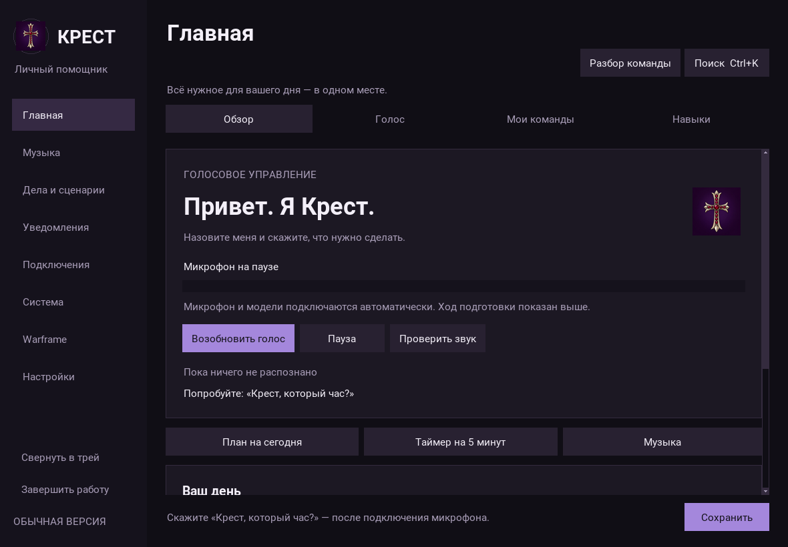
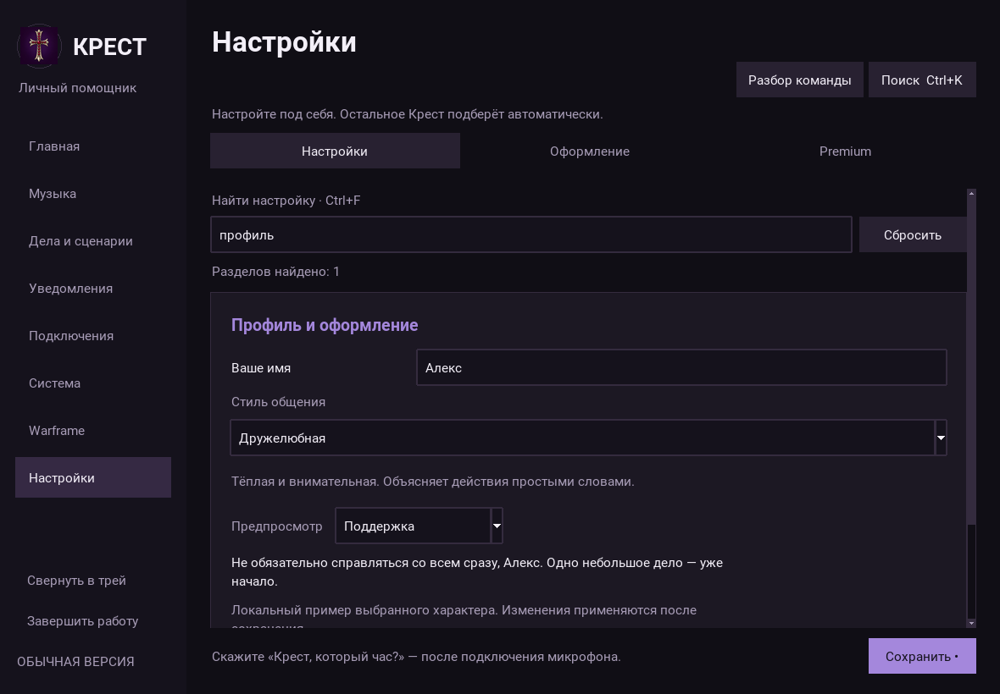
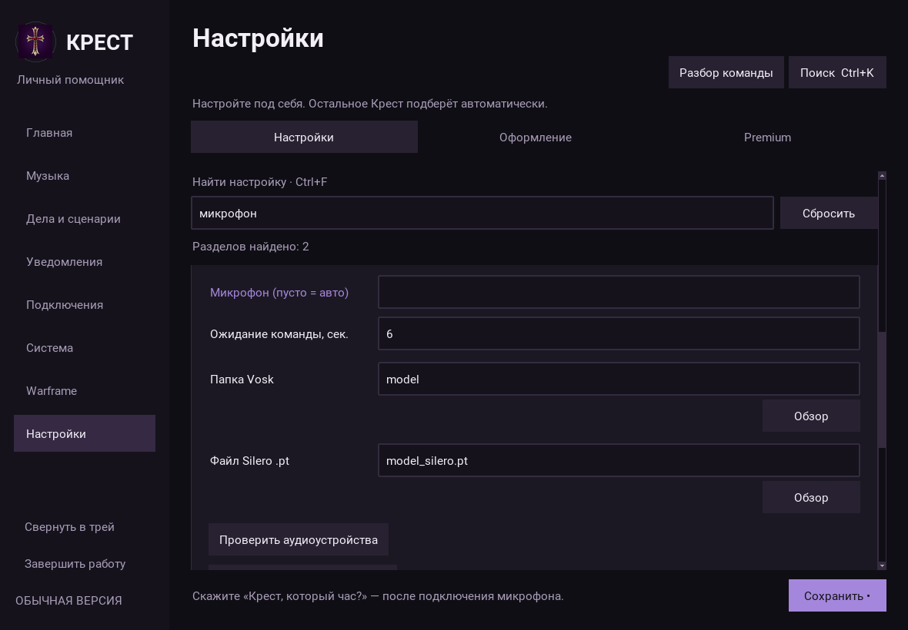
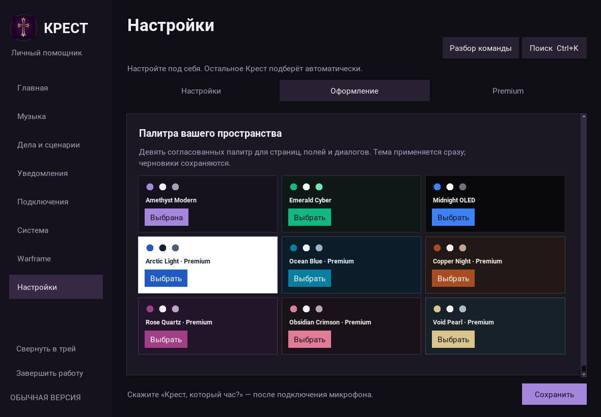
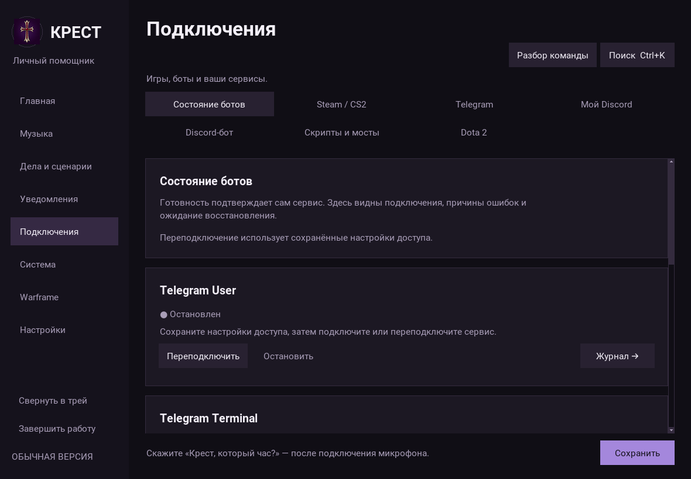
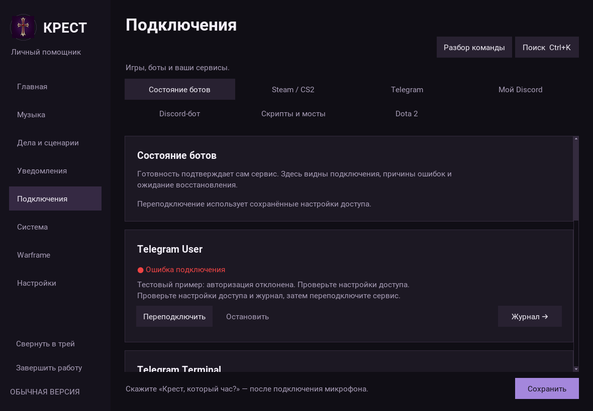
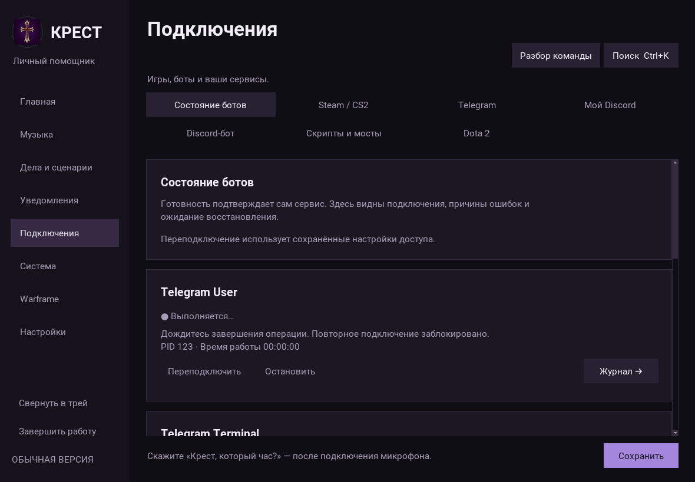
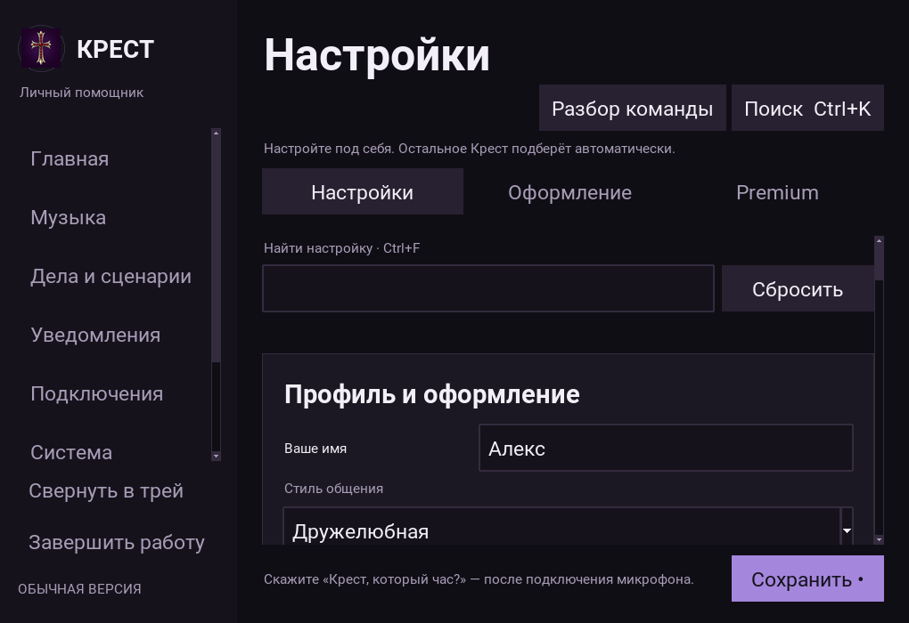

# КРЕСТ: меню, диалоги и надёжность ботов

Работа выполнена в отдельной ветке `improve/menu-personality-bots-20261011` от
`4c5be67` (актуальный `origin/main` при начале аудита). Главная ветка не изменялась,
публикации и развёртывания не выполнялись. Реальные сообщения не отправлялись.

## Аудит исходной версии

Предыдущие заявления перепроверены на отдельной неизменённой копии исходников:
**333 passed, 3 skipped**, **158 навыков**, ошибок загрузки нет. Это Linux/Xvfb,
Python 3.12; три пропуска относятся к Windows. Локальных `AGENTS.md` и
`.agents/skills` в репозитории не обнаружено; прочитаны README, предыдущий отчёт
и документация сборки.

Главные подтверждённые проблемы:

- Частицы и панель эффектов продолжали создавать Canvas и таймеры.
- Каталог навыков полностью перестраивался при каждом возврате, теряя время на
  повторные чтения настроек и перерисовку строк.
- При 150% масштабе обрезались навигация и галерея тем.
- Часть характеров отличалась добавленной фразой, краткий стиль повторял один ответ.
- Автоответчики обещали передачу сообщений и метку срочности без такой реализации.
  Срочный текст обходил обычное ограничение повторов; ключи антиспама Discord
  расходились для входящих и исходящих сообщений.
- Steam Terminal трактовал `cache_expiration` как снятие ограничения обмена;
  ошибки могли выглядеть как пустой результат, кэш не был привязан к аккаунту.
- Экран ботов не отличал запущенный процесс от подтверждённого подключения;
  отдельный процесс ядра требовал совместимой реализации переподключения.
- Отдельный этап создания установщика позволял обойти runtime-проверку сборки.

## Что изменено

### Меню

Полностью удалены декоративные эффекты: кровь, снег, искры, звёздная пыль, их
предпросмотр и управляющая панель. Старые настройки эффекта переводятся в `off`.
Игровой крест, индикатор речи, девять тем и прочие страницы сохранены.

Настройки получили поиск по подписям карточек и скрытых параметров (`Ctrl+F`),
состояние пустого результата и очистку поиска. Поиск раскрывает нужные параметры,
не меняет введённые значения и переживает смену темы. Предпросмотр личности
работает по выбранному стилю, имени и ситуации до сохранения профиля.

Галерея тем адаптирует число колонок, длинные подписи переносятся. При увеличенном
масштабе боковая навигация получает полосу прокрутки; фокус клавиатуры прокручивает
скрытую кнопку в видимую область. Убрано накопление callbacks, анимация перехода
отменяется перед перестройкой темы. «Уменьшить движение» применяется к анимации
немедленно. Каталог навыков обновляет строки только при изменении данных, поиска
или доступности, сохраняя выделение. В стартовом помощнике устранено освобождение
Tk-объектов в фоновом потоке после закрытия окна; такой сбой мог завершить процесс.

### Личности и навыки

Семь характеров получили собственные полноценные наборы ответов: дружелюбная,
краткая, живая, спокойная, штурман, ироничная, хранительница. Фразы перемешиваются
без повторов до конца набора. Поддержка различает усталость, неудачу и тревогу;
ирония не применяется к уязвимым ситуациям. Во всех девяти основных сценариях
каждого характера — минимум три самостоятельных ответа: всего 231 стилизованная
реплика плюс 12 общих фактов. Это **локальные сценарии и правила**,
а не генеративная языковая модель.

Викторина содержит 15 вопросов с объяснениями и поддерживает подсказку, повтор
вопроса и остановку. Добавлены шесть вычислительных/календарных навыков:

| Команда | Результат |
| --- | --- |
| `15 процентов от 2400` | 360 |
| `скидка 15 процентов на 2490` | 2116,50; экономия 373,50 |
| `раздели счёт 100 на 3` | 1 человек по 33,34; 2 по 33,33 |
| `сколько дней между 28.02.2024 и 01.03.2024` | 2 дня |
| `какой день недели 01.01.2027` | пятница |
| `дата через 30 дней от 01.01.2027` | 31.01.2027 |

Исправлены минус и десятичная запятая в старом конвертере; ошибочный ввод больше
не подменяется единицей. Всего **167 навыков**, все прежние 158 идентификаторов
сохранены: [машинное сравнение](validation/skill-comparison.json).

### Боты

Экран состояния различает остановку, запуск, подтверждённую готовность, ошибку
и ожидание восстановления. Кнопки отключаются сразу после нажатия; менеджер
отклоняет одновременные операции, а отдельное ядро поддерживает тот же контракт.
Ошибки сохраняются после завершения процесса; доступен переход к журналу.

Telegram/Discord ограничивают повторные срочные сообщения, отменяют ожидающий
автоответ после ответа владельца и безопасно ограничивают длину текста.
Разметка внешнего статуса не превращается в упоминания. Обещания несуществующей
доставки удалены, очистка автоответа описана как попытка. Фоновые Discord-задачи
отменяются при закрытии. Секреты сетевых исключений не выводятся в журнал.

Steam Terminal использует общий клиент, корректную пагинацию предложений обмена,
реальное количество предметов и только подтверждённые сроки. Кэш атомарен,
привязан к аккаунту; устаревшие данные и ошибки явно обозначаются.

Разрешения удалённого управления и существующие ограничения Premium сохранены.
Новые внешние сервисы, платные API, 3D и автономная отправка не добавлялись.

### Установщик

`--stage installer` требует подтверждения успешного `--stage verify`, связанного
с SHA-256 каждого файла дистрибутива. Изменённые/добавленные/удалённые файлы
требуют новой проверки. Каталог встроенных навыков EXE сверяется с исходниками
по точным идентификаторам. Ошибка завершения дочернего ядра проваливает проверку;
диагностические журналы сохраняются и при сбое.

Наличие этих изменений **не означает готовность Windows-установщика**. Последнее
состояние указанного запуска и наличие артефактов фиксируются отдельно в
[проверке GitHub Actions](validation/windows-workflow.json).

## Визуальная проверка

Снимки получены с настоящих Tk-виджетов в Linux/Xvfb, Python 3.13 / Tk 8.6,
с временным профилем без фоновых подключений. Premium разблокирован только
подменой проверки в процессе съёмки; лицензии и продуктовая проверка не менялись.
Системная рамка и рендеринг Windows могут отличаться.

Все снимки и подробные замеры: [menu-review](menu-review/performance.json).
Сценарий воспроизведения: `tools/capture_menu_review.py`.

## Проверки и ограничения

| Проверка | Результат |
| --- | --- |
| Исходный `4c5be67`, Python 3.12 | 333 passed, 3 skipped |
| Доработка, Python 3.12 | 606 passed, 3 skipped |
| Доработка, Python 3.13 / Tk 8.6 | 606 passed, 3 skipped |
| Реестр навыков | 167, ошибок 0; удалённых обработчиков 0 |
| Ruff / compileall / git diff --check | успешно |
| Старт меню, офлайн-профиль | 194.25 мс |
| Стресс меню | 720 переходов, 120 смен темы; callbacks ошибок 0 |
| Длительный прогон ядра | 601.3 с, 60 команд, 20 переподключений |
| Ядро: p95 snapshot / файловые дескрипторы | 10.85 мс / 6 → 6 |

Оба финальных прогона включают `-W error::pytest.PytestUnraisableExceptionWarning`:
ошибки финализаторов Tk не скрыты предупреждениями. Осталось одно стороннее
предупреждение Pyrogram о цикле событий при импорте. Три пропуска — платформенные
Windows-проверки; точные имена и причины перечислены в машинном отчёте.

В стресс-тесте меню повторные создания страниц входят в замер: медиана
9.85 мс, p95 23.89 мс, максимум
463.93 мс. Это более тяжёлый сценарий, чем переход между уже
построенными страницами; максимум также приведён, чтобы не скрывать задержки.
RSS во время этого короткого стресса изменился с 52.43 до
55.07 МБ; это не многочасовая оценка памяти.

Итоговые числа тестов и замеры приведены в [машинном отчёте](validation/summary.json).
Полные JUnit-результаты сохранены рядом. Проверки покрывают настоящий дочерний
kernel, IPC, локальные расчёты, маршрутизацию, ошибки и гонки ботов на фикстурах,
все страницы меню, темы, черновики, поиск, адаптивность и отмену анимаций.

Дополнительный десятиминутный прогон отдельного ядра сохраняет результаты в
[kernel-soak.json](validation/kernel-soak.json). Дополнительный стресс меню:
720 переходов и 120 перестроений темы, [полный результат](validation/menu-soak.json).
После завершения нет оставшихся заданий анимации и Canvas-элементов перехода,
количество callbacks переменных не растёт. Это ограниченный прогон, а не доказательство
отсутствия всех возможных утечек.

Оставшиеся ограничения:

1. Реальный микрофон, SMTC-плеер, Windows-трей, compositor, игровой OCR и работа
   в настоящей игре здесь не проверены. Linux-результаты их не заменяют.
2. Реальные аккаунты Telegram/Discord/Steam не подключались. Вход, доставка и
   ответы API требуют отдельной проверки владельцем с его настройками.
3. Сборка Nuitka/Inno Setup и установка EXE требуют Windows. Ветка с этими
   изменениями не публиковалась и workflow для неё не запускался.
4. Новые расчёты принимают числа цифрами; календарь принимает `ДД.ММ.ГГГГ`, ISO
   и слова сегодня/завтра/вчера. Свободная беседа ограничена локальными наборами.
5. Замеры UI сделаны без моделей, сети и реальных игр; они не обещают одинаковую
   скорость на Windows. Проверка отсутствия Canvas-остатков не заменяет визуальную
   проверку графических шлейфов на проблемном компьютере.

Идеи вне реализации: генеративная модель для свободной беседы, новые крупные
интеграции и отдельный 3D-образ. Для них нужен отдельный согласованный объём.

## Независимая повторная проверка

Три независимых агента проверили логику, безопасность и UI. Найденные ошибки
исправлены и повторно проверены: [полный журнал](validation/INDEPENDENT_REVIEW.md).
Итог: **606 passed, 3 skipped** на каждой из двух версий Python;
**27 настоящих PNG**, 45 сочетаний тем/страниц при 150% без обрезания по ширине.
Поиск показывает конкретное поле, боты сохраняют честный статус ошибки,
неудачная остановка не теряет процесс, расчёты отклоняют неверные числа.
