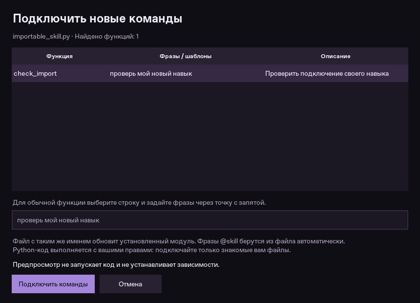

# Импорт навыков через меню

Откройте **Главная → Навыки → Импортировать .py**. Выберите файл, проверьте список
найденных функций и нажмите **Подключить команды**. Перезапуск Крест и изменения
`main.py`, `skills/` или конфигурации вручную не нужны.

Команды появляются в общем каталоге и поиске. Их можно вводить текстом и произносить
с обычным обращением к Крест. Включённые модули загружаются при следующих запусках.
Подключения ботов и Premium для импорта навыков не требуются.



## Готовый навык

Файл [examples/importable_skill.py](../examples/importable_skill.py) можно сразу
выбрать в меню и проверить фразой «проверь мой новый навык».

Если функция уже использует `@skill`, Крест берёт команды, шаблоны, описание,
категорию и примеры из декоратора автоматически:

```python
from skill_manager import skill

@skill(
    keywords=["моя новая команда"],
    description="Описание моей функции",
    category="Мои навыки",
)
def my_command():
    return "Функция выполнена."
```

В одном файле может быть несколько навыков. Кнопка **Скачать шаблон** сохраняет
минимальный рабочий файл, который можно сразу импортировать.

## Обычные функции без декоратора

```python
def greet():
    return "Привет! Эту функцию добавили через меню."
```

Крест найдёт `greet`. В предпросмотре выберите её строку и задайте фразы, например
`поздоровайся по новому; моё приветствие`. Изменять исходный файл для привязки фраз
не требуется. Имена обычных функций по умолчанию превращаются в команды, `_`
заменяется пробелом. Лучше задать понятную русскую фразу.

Поддерживаются обычные синхронные функции верхнего уровня. Обязательные параметры
могут называться `text` (полный текст команды) и `state` (состояние Крест).
У декорированных навыков также поддерживаются именованные группы регулярного
выражения. Другие обязательные параметры автоматически заполнить нельзя — такая
обычная функция будет пропущена с объяснением. Классы, async-функции и функции с
посторонними декораторами не подключаются автоматически.

Верните строку для ответа пользователю. Для сообщения об ошибке можно вернуть
`{"status": "error", "message": "Описание проблемы"}`. Не вызывайте функцию
самостоятельно внизу файла: действия должны находиться внутри функции и выполняться
по команде, а не во время импорта. Блок `if __name__ == "__main__":` при подключении
не запускается.

## Обновление и управление

- Повторный импорт файла **с тем же именем** обновляет этот модуль, включая его набор
  команд. Прежние команды исчезают, новые появляются без перезапуска.
- **Отключить** убирает команды из активного каталога, сохраняя файл и привязки.
- **Включить** возвращает команды. Состояние сохраняется между запусками.
- **Удалить** удаляет установленную копию. Первоначальный выбранный файл не удаляется.
- Прямое совпадение фразы или шаблона с другой командой блокирует установку.
  Для обычной функции измените фразу в предпросмотре; для `@skill` исправьте её в файле.
  Пересечение разных регулярных выражений в общем случае автоматически не определяется.
- Ошибка импорта, недостающая библиотека или ошибка сохранения не заменяет рабочую
  предыдущую версию. В меню показывается причина. Зависимости автоматически не
  скачиваются и не устанавливаются.
- Если сейчас выполняется команда, дождитесь её завершения и повторите подключение.

## Формат и хранение

Поддерживается один `.py` файл в UTF-8, до 512 КБ и до 50 функций. Можно подключить
до 100 модулей. Многофайловые пакеты, соседние ресурсы и ZIP-архивы этот импорт не
устанавливает; нужные библиотеки должны быть в окружении Крест.

Установленные копии и привязки лежат в `imported_skills/` рядом с используемым
`config.json`. Профили с разными путями конфигурации имеют свои наборы навыков.
Исходную папку выбирать при каждом запуске не нужно. Эти данные исключены из Git;
для переноса на другой компьютер сохраните папку отдельно. Обычный архив резервной
копии настроек пока не включает Python-модули.

Предпросмотр только разбирает текст Python, не запускает его. При подключении и
следующем запуске Python выполняет код модуля с правами пользователя — импорт не
является песочницей. Подключайте свои или проверенные файлы. Откат возвращает
регистрацию команд и сохранённую версию, но не может отменить произвольные внешние
действия, выполненные самим модулем во время импорта.

В безопасном режиме сторонние навыки не загружаются. Если импортированный файл
мешает запуску, остановите ядро и используйте `python main.py --safe-mode`, затем
отключите или удалите модуль через меню.
