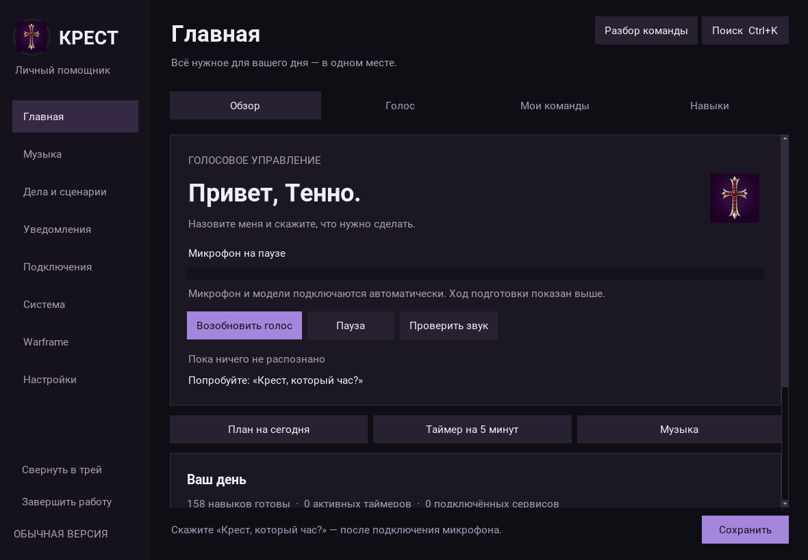
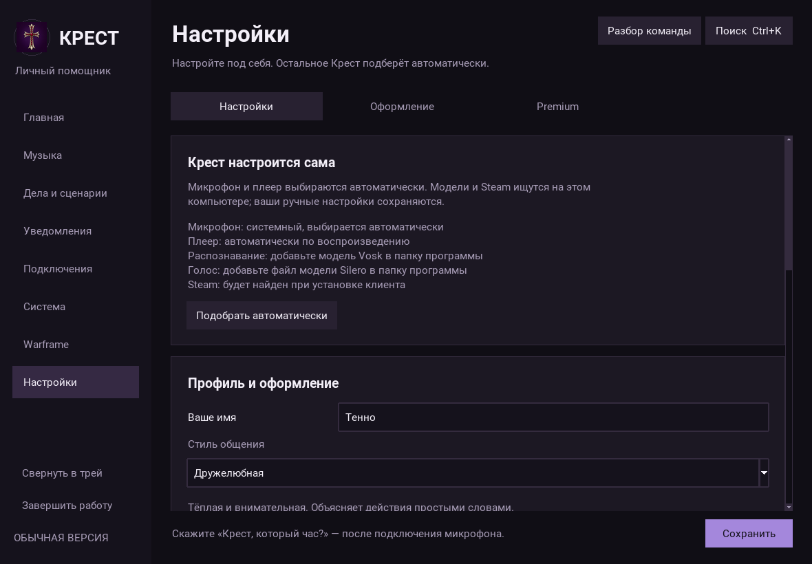
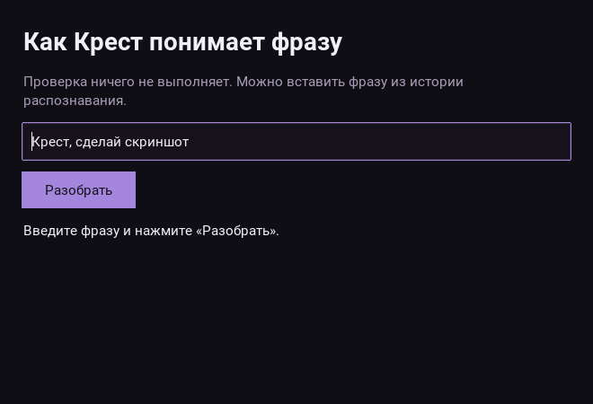

# Крест 0.9 — отзывчивое меню, автоматический голос, подготовка Windows-релиза

## Что изменилось

- Карточки используют обычные непрозрачные виджеты вместо вложенных Canvas.
  Убрано прозрачное окно эффектов над всей площадью меню. Снег, искры, звёзды и
  потёки остаются в полосе эффектов и предпросмотре, не перекрывая текст.
- Системные вкладки и страницы Warframe строятся по одной и затем переиспользуются.
  Переход сопровождается коротким движением акцентной полосы; текст появляется сразу.
  «Уменьшить движение» отключает анимацию. Черновики настроек переживают смену темы.
- Голос включается при запуске после первого знакомства, если автозапуск голоса
  не отключён пользователем. При отсутствии моделей Windows-версия получает
  Vosk small ru 0.22 и Silero v4 с официальных HTTPS-серверов. Ранее найденные модели
  имеют приоритет и не заменяются. Загрузка идёт в фоне, прогресс виден на главной.
  При первой подготовке нужен интернет и свободное место; дальнейшая речь локальная.
- После ошибки голос повторяет подключение через 30 секунд. Пауза останавливает
  повторы. Проверка микрофона сама временно приостанавливает распознавание и
  возобновляет его. Если загрузка Silero не удалась, доступное распознавание Vosk
  продолжает работать с текстовыми ответами.
- Исправлено обращение к статическому `OcrEngine.max_image_dimension`. Если язык
  профиля Windows не подходит, OCR пробует установленные языки распознавания.
  Отсутствующие языковые компоненты Windows автоматически не устанавливаются.
  Warframe обнаруживается по процессу, затем читается только активное окно игры.
  Сеть, личные записи и OCR работают независимо от открытой вкладки.
- Семь стилей общения: дружелюбная, краткая, живая, спокойная, штурман, ироничная,
  хранительница. У новых характеров свои приветствия, поддержка, шутки и ответы.
  «Расскажи факт», «давай поговорим», «мне скучно», «задай вопрос», «мой ответ …»
  работают локально. Это набор диалогов и правил, без языковой модели.
- Кнопка **Разбор команды** в верхней панели показывает результат нормализации,
  навык, доступность и параметры. Проверка ничего не выполняет. Исправлена
  обработка пользовательских синонимов, которые указывают на естественную фразу.
- «Крест, сделай скриншот» теперь действительно сохраняет PNG всех мониторов.
  «Открой скриншоты» и одноимённая кнопка главной страницы открывают папку.
  Команда «ножницы» отдельно вызывает выделение Windows.

## Где файлы

В исходниках: `screenshots` рядом с `main.py` (либо рядом с выбранным `--config`).
В установленной программе: `%LOCALAPPDATA%\Krest\Data\screenshots`.
Модели первого запуска находятся в подпапке `models` каталога данных.
Снимки Warframe, сделанные через игровую закладку, остаются отдельно в `captures`.
В сообщении об успешном снимке показан полный путь. При ошибке записи успех не сообщается.

## Сборка программы

[Инструкция по установщику](WINDOWS_RELEASE.md). Добавлены компиляция Nuitka,
переносимые точки входа ядра/индикатора/ботов и Inno Setup. GitHub Actions собирает
установщик на Windows и проверяет отдельный процесс ядра уже из собранного EXE.
Скрипт сборки не включает пользовательские конфиги, сессии и приватные ключи.

## Проверки и пределы

В облачной Linux-среде: **330 тестов прошли, 3 Windows-проверки пропущены**.
Загружены 158 навыков без ошибок.

Регрессионные тесты охватывают маршрутизацию всех ключевых фраз и примеров,
разделение скриншота и ножниц, PNG на диске, OCR API, загрузку моделей на фикстурах,
характеры, викторину, отдельное создание страниц и сохранение черновиков.
Проверка ядра запускает реальный дочерний процесс, разбирает команду, выполняет
запрос времени и завершает только запущенное для проверки ядро.

[Замеры интерфейса](ui-performance.json) получены в Linux/Xvfb без фоновых сетевых
запросов и голосовых моделей: создание меню 172 мс; проверенные новые страницы
11–22 мс, повторные переходы 2–4 мс. Это измерения облачной среды, не обещание
такой же скорости на Windows. Проверить исчезновение графических шлейфов нужно
на проблемном компьютере, включая его масштабирование дисплея.

В этой облачной среде нет Windows-компилятора и реального микрофона. Доступ к
серверам моделей и API GitHub заблокирован сетевым шлюзом (403), поэтому здесь
не проверены реальные загрузки моделей, сборка EXE, установка, звук и OCR в игре.
Успешную сборку Windows следует подтверждать зелёным запуском соответствующего
workflow и его артефактом, а не наличием скриптов в репозитории.

## Как проверить у себя

1. Полностью завершите Крест через меню и обновите исходники.
2. Откройте `start.bat`. После знакомства дождитесь статуса микрофона на главной;
   если моделей нет, увидите подготовку. Назовите «Крест, который час?».
3. Прокрутите длинные страницы, переключитесь между Warframe, памятью и настройками.
   Попробуйте эффекты и режим уменьшенного движения.
4. Скажите «Крест, сделай скриншот», затем «Крест, открой скриншоты».
5. Запустите Warframe, переключитесь на игру и дождитесь наблюдения экрана.
   В журнал попадают только известные экраны после двух подтверждений; весь чат
   и произвольный текст не сохраняются, инвентарь по OCR не выдумывается.
6. В профиле выберите характер и нажмите «Пример ответа». Попробуйте викторину.

