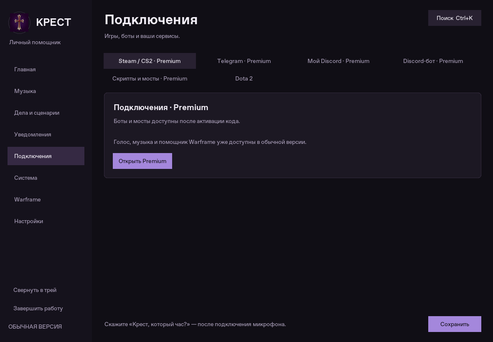

# Голос, быстрый запуск и помощник Warframe

## Что исправлено

- Ошибка `'charmap' codec can't encode character '\u2705'` возникала при печати
  сообщения об успешной загрузке Silero. Движок использует журнал вместо `print`;
  этот сбой больше не прерывает включение микрофона. Есть регрессионный тест с
  настоящим импортом движка, подставными моделями и строгим выводом CP1251.
- Один и тот же поиск моделей используется в меню, диагностике и голосовом ядре.
  Он работает относительно папки исходников, независимо от текущей папки терминала.
  Учитывает вложенную распаковку Vosk, `model/`, `models/`, `voice/`, файлы Silero
  `*silero*.pt`, `v4_ru.pt`, `v3_1_ru.pt`, `v3_ru.pt`. Рабочие ручные пути сохраняются;
  отсутствующие пути со старого ПК не блокируют поиск. При неоднозначности модель
  не выбирается произвольно.
- Для распознавания достаточно Vosk, sounddevice и numpy. Недоступная озвучка
  больше не выключает распознавание; ответы остаются в меню. Сами модели не заменены.
- После знакомства Крест запускает голос автоматически (если автозапуск голоса
  не отключён ранее). Ошибка отображается прямо на главной. При возвращении в меню
  состояние берётся из работающего ядра, а не сбрасывается на «голос выключен».
- Добавлен ограниченный адаптивный порог фонового шума. Он не учится во время уже
  начавшейся фразы; хранит максимум 120 замеров в памяти и сбрасывается при
  переподключении микрофона. Это подстройка чувствительности, **не обучение
  акустической модели голосу владельца**. Ручной порог доступен после отключения
  переключателя автоматической чувствительности на странице голоса.
- Частый цикл распознавания читает настройки не чаще двух раз в секунду вместо
  двух полных копий конфигурации на каждый проход.

## Меню и нагрузка

Главная начинается с голосового управления: состояние, уровень, распознанная фраза,
подключение, пауза, проверка. Ручной ввод находится в сворачиваемом разделе;
Ctrl+L раскрывает его и прокручивает к полю. Страница голоса теперь рядом с обзором.
Проверка звука и точные настройки остаются доступны, но не нужны для обычного запуска.

Страницы создаются по мере открытия, некоторые связанные редакторы — группой.
Смена темы перестраивает только уже открытые страницы, сохраняя черновики.
На старте локального меню в одном и том же профилировочном сценарии число
созданных Tk-виджетов уменьшилось с **1521 до 207**. Это измерение Linux/Xvfb,
без загруженных аудиомоделей; оно не обещает такую же задержку на конкретном Windows-ПК.
Скрытое меню опрашивается реже, скрытые индикаторы микрофона не перерисовываются.
Наблюдение за процессами ботов в цикле ядра выполняется раз в секунду вместо десяти.

В обычной версии вкладки Telegram, Steam-монитора, Discord и мостов показывают
экран Premium. Формы ключей и управления не создаются до открытия доступной страницы.
При истечении лицензии открытая форма скрывается; настройки не стираются.
Ограничения запуска сервисов в ядре сохранены. Warframe и локальное голосовое
управление доступны бесплатно.




## Проверка на вашем компьютере

1. Закройте старое ядро Крест через «Завершить работу» (закрытие окна в трей не
   завершает процесс). Обновите исходники из `main`, сохранив свою папку `model`
   и файл голоса. Не удаляйте конфигурацию и пользовательские данные.
2. Если зависимости уже установлены, достаточно обычного запуска `python main.py`.
   Для новой установки используйте команды ниже, из папки проекта.
3. Введите имя при первом знакомстве. Дождитесь подключения на главной. Скажите
   **«Крест, который час?»**. Индикатор должен реагировать, фраза — появиться в меню.
   После добавления модели при уже запущенной программе нажмите **Подключить голос**.
4. Проверьте «Пауза», затем подключение; отключите и подключите USB-микрофон.
   Если Windows не разрешает запись, включите доступ к микрофону для настольных
   приложений в параметрах конфиденциальности Windows. Программа не меняет это
   системное разрешение автоматически.
5. Откройте несколько вкладок и смените тему. В обычной версии попробуйте открыть
   подключения — должен показываться экран Premium.
6. Запустите Warframe в оконном режиме без рамки. В игре OCR работает автоматически,
   при Alt+Tab чтение приостанавливается. Вернувшись в меню, откройте Навигатор:
   там показан результат или причина недоступности. Произнесите
   **«Крест, что видишь в Варфрейме?»**. Для записи известный экран должен оставаться
   видимым два чтения, обычно 15–30 секунд.

```powershell
.venv\Scripts\python -m pip install -r requirements-voice.txt
.venv\Scripts\python -m pip install -r requirements-windows.txt
.venv\Scripts\python main.py
```

OCR использует встроенный распознаватель Windows через уже имеющийся пакет winsdk,
без дополнительной тяжёлой модели. Поддержка ограничена известными надписями:
миссия завершена/провалена, выбор награды, кузница, арсенал, звёздная карта.
Снимки и прочитанный чат не сохраняются; в журнал попадает только название экрана.
Прогресс, инвентарь и награды автоматически не меняются. Это не полный доступ
к профилю и не распознавание врагов или всех игровых ситуаций.

Подробности и ограничения — в [описании Warframe](WARFRAME.md#локальное-чтение-экрана).
Реальные микрофон, Vosk/Silero и Windows OCR на машине пользователя в облаке
недоступны: тесты проверяют код с подставными аудио/модельными/экранными источниками,
а интерфейс проверяется на виртуальном дисплее. Финальная проверка слышимости,
задержки и качества OCR остаётся на Windows.
