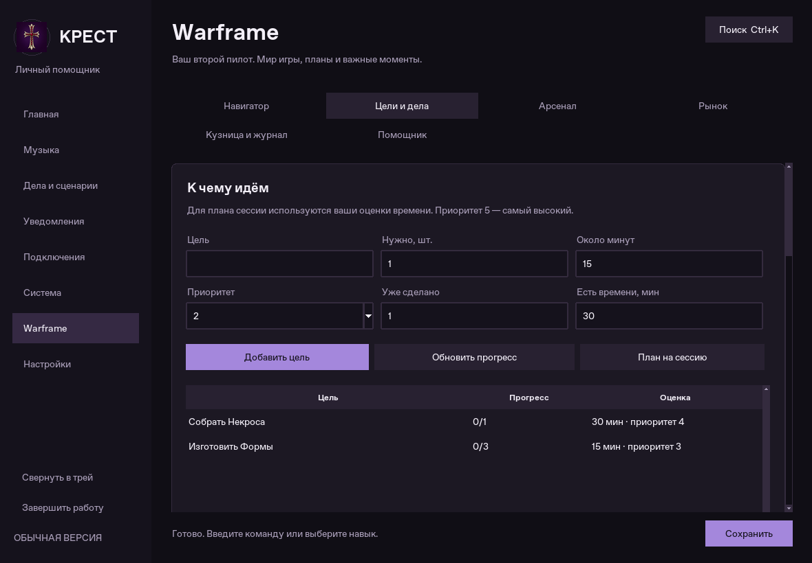
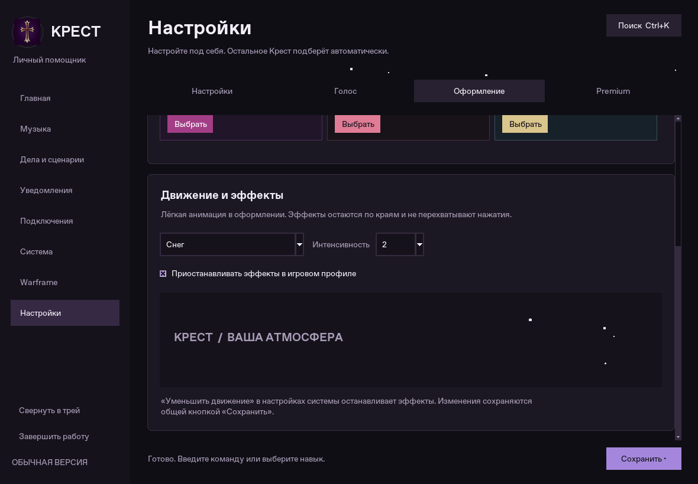

# Крест × Warframe

Обновление исходников: игровой помощник, маленький индикатор поверх игры,
автоматическое подключение микрофона и эффекты оформления. Vosk и Silero остаются
прежними. Нейросетевая генерация ответов и новая тяжёлая модель не добавлены.

## Начать пользоваться

1. Завершите старое ядро через меню или `python main.py --stop-kernel`, закройте меню
   и обновите исходники. Запустите `python main.py --check`, затем `python main.py`.
2. Откройте **Warframe → Помощник**. Для ПК настройки уже выбраны: обнаружение игры,
   сводка, игровой профиль, напоминания и крест справа вверху. Другой угол и размер
   можно выбрать здесь же. Общая кнопка **Сохранить** применяет настройки.
3. Запустите игру из Крест или привычным способом. Процесс `Warframe.x64.exe` /
   `Warframe.exe` обнаруживается примерно за пять секунд. Индикатор появляется
   в Windows; рекомендуемый режим игры — **оконный без рамки**.
4. Добавьте цель в **Цели и дела**, укажите количество и примерное время. Запасы
   ресурсов и ранги модов вносятся в «Мою коллекцию». Это нужно для расчёта нехватки.
5. В **Главная → Голос** оставьте микрофон пустым для автоматического выбора.
   При установленных прежних моделях голос включается при следующем запуске Крест;
   автозапуск можно выключить. Есть прежняя ручная кнопка «Включить».
6. В **Настройки → Оформление** выберите тему, эффект и интенсивность.

Подключать аккаунт Warframe, передавать пароль или устанавливать игровой плагин
не нужно. Крест использует публичные сведения и ваш локальный блокнот.

Снимок настоящего меню в тестовой среде; цели на нём созданы для демонстрации.

## Возможности по всем 24 направлениям

| Направление | Что реализовано |
| --- | --- |
| 1. Сводка при запуске | Обнаружение процесса, личные цели и публичная сводка мира; данные запрашиваются в фоне. |
| 2. Циклы миров | Равнины Эйдолона, Долина Сфер, Камбионский Дрейф, Зариман; фаза, срок и напоминание перед сменой. |
| 3. Игровые события | Разломы, вторжения, сигналы тревоги, события, вылазка и охота на Архонта; фильтр списка и уведомления по словам наград. |
| 4. Баро | Прибытие, отъезд, опубликованный ассортимент; совпадения с личными целями и расчёт дукатов/кредитов. |
| 5. Личные цели | Количество, прогресс, приоритет, оценка времени, изменение и удаление. |
| 6. План изготовления | Рецепт из справочника, компоненты, отмеченное наличие, нехватка, кредиты и время; порядок действий. |
| 7. Реликвии | Поиск по награде или названию, варианты улучшения, шансы наград, признак хранилища из источника. |
| 8. Следы Бездны | Калькулятор улучшения нескольких нетронутых реликвий с учётом уже имеющихся следов. |
| 9. Ресурсы | Места и практические рекомендации для основных ресурсов; поиск по каталогу и переход к поиску в Wiki. |
| 10. Кузница | Таймер по рецепту либо введённой длительности, сохранение между запусками, уведомление, отметка получения. |
| 11. Чек-листы | Разовые, ежедневные и еженедельные дела; отметка выполнения, её отмена, час сброса UTC. |
| 12. Ночная Волна | Задачи и репутация из источника; предложения проверить совместимость похожих по словам задач; добавление в личный список. |
| 13. План по времени | Выбор невыполненных дел по приоритету, которые помещаются в заданный бюджет времени. Оценки берутся из ваших записей. |
| 14. Сборки | Сохранение, редактирование, список модов с рангами, заметка и ссылка. |
| 15. Проверка модов | Сравнение с отмеченной коллекцией и расчёт эндо/кредитов для усиления известных обычных модов. |
| 16. Рынок | Поиск предметов, предложения продажи, фильтр ранга и онлайн-статуса; копирование сообщения конкретному продавцу. |
| 17. Сигналы цены | Сохранённые пороги, включение/пауза, фоновая проверка и ограничение повторных оповещений. |
| 18. Сделки | Ручной журнал покупок и продаж, количество, цена за штуку и баланс записанных сделок. |
| 19. Сессии и заметки | Автоматическая запись начала/окончания игры, длительность, голосовые метки и просмотр последних записей. |
| 20. Игровой момент | Метка голосом; по отдельным настройкам — скриншот активного окна Warframe и запрос последнего клипа Xbox Game Bar. |
| 21. Игровой профиль | Временный игровой режим Крест, важные уведомления и выбранная громкость фоновых приложений; возврат после выхода. |
| 22. Состояние ПК | Пороги памяти, свободного места на диске данных Крест и температуры доступных через psutil датчиков. |
| 23. Индикатор и меню | Отдельный процесс с маленьким крестом, реакция на голос и состояние сервисов; шесть страниц Warframe. |
| 24. Запуск и сценарии | Запуск через Steam AppID 230410 или выбранный EXE/ярлык; автоматический запуск вашего сохранённого сценария после обнаружения игры. |

Управление в меню распределено между **Навигатором**, **Целями и делами**,
**Арсеналом**, **Рынком**, **Кузницей и журналом**, **Помощником**.

## Голосовые команды

Скажите обращение «Крест», затем команду. В текстовом поле обращение не обязательно.
Добавлены 22 навыка, общий встроенный каталог — 149 навыков.

- «Сводка варфрейм», «обнови варфрейм», «циклы варфрейм», «события варфрейм».
- «Баро», «когда Баро», «Ночная Волна».
- «Варфрейм цель собрать Некроса», «мои цели варфрейм».
- «Варфрейм каждый день проверить синдикаты».
- «Варфрейм каждую неделю охота на Архонта».
- «Варфрейм план на тридцать минут».
- «Варфрейм где фармить нейроды», «варфрейм рецепт форма».
- «Варфрейм реликвии для Wisp Prime», «варфрейм следы для 4».
- «Варфрейм кузница форма на двадцать три часа», «кузница варфрейм».
- «Варфрейм проверь билд мой Некрос» — сборку сначала сохраните в меню.
- «Варфрейм рынок Wisp Prime Set» — предложения выбранного предмета открываются в меню.
- «Варфрейм запомни завтра собрать нейроды», «варфрейм сохрани момент», «журнал варфрейм».
- «Запусти варфрейм».

Большая часть справочников содержит английские названия. Есть начальный словарь
русских названий; собственные соответствия добавляются в «Цели и дела».
Для управления произношением остаётся отдельный словарь на странице «Голос».
Поиск не выполняет произвольные команды из найденных описаний.

## Крест в углу монитора

| Цвет | Состояние |
| --- | --- |
| Голубой | Warframe обнаружен; игровые сервисы работают в ожидании событий. |
| Зелёный | Голос включён, микрофон подключён и уровень звука превышает настроенный порог. |
| Золотой | Выполняется команда или операция Warframe. |
| Фиолетовый | Крест озвучивает ответ. |
| Оранжевый | Недавно появилось новое уведомление Warframe. |
| Красный | Последняя ошибка сервиса или проблема подключения микрофона. |

Пульсация реагирует на уровень звука, а не на разбор картинки игры. Подпись можно
выключить; размер задаётся от 32 до 96 px, доступны четыре угла. Надпись расширяет
общую область индикатора до 124 px. Наложение пропускает клики и не должно
перехватывать фокус. При переключении на другое приложение по умолчанию скрывается.
Работает вместе с ядром, даже если меню закрыто. «Уменьшить движение» отключает
пульсацию, сохраняя цвета состояний.

Это обычное окно поверх игры, без внедрения в процесс. Эксклюзивный полноэкранный
режим может его скрывать. «Наблюдаю» означает проверку процессов, таймеров и
публичных событий: распознавание миссии или содержимого экрана не реализовано.

## Микрофон и сохранение лёгкого голоса

- Автоматический выбор доступного входа, предпочтение системного микрофона.
- Указанное вручную устройство проверяется первым; при его недоступности есть
  переход к другим физическим входам.
- Стереомикшер и явно обозначенные loopback-источники автоматически не выбираются:
  их можно задать только явно.
- Проверяется поддержка формата. Если 16 кГц недоступны, используются собственная
  частота устройства, 48 или 44,1 кГц; поток преобразуется в моно 16 кГц для Vosk.
- При отключении, остановке потока или пропаже звуковых блоков слушатель пробует
  подключиться повторно; частота попыток ограничена. Список устройств PortAudio
  обновляется после сбоев, когда Крест не воспроизводит звук.
- В меню видны выбранное устройство, уровень и ошибка подключения.
- Отсутствие микрофона не выгружает уже загруженные модели; при подключении
  устройство можно восстановить без повторной загрузки моделей.
- Новая настройка автозапуска голоса действует при запуске ядра. Если модели ещё
  не установлены, их никто не скачивает автоматически. После установки включите
  голос вручную или перезапустите Крест. Safe mode не запускает голос автоматически.

Разрешение Windows «Доступ к микрофону для классических приложений» должно быть
включено. Выбор устройства не может обойти запрет системы.

## Оформление и нагрузка

Добавлены **Obsidian Crimson** и **Void Pearl**. Всего девять тем: три базовые и
шесть Premium; прежняя активация кодом сохранена. Экран оформления показывает
образцы палитр. Сам Warframe-помощник и переключатель эффектов доступны без активации
ботовых интеграций.

Эффекты: **снег**, **кровавые потёки**, **тлеющие искры**, **звёздная пыль** и
**выключено**. Интенсивность ограничивает количество частиц до 8/16/26 на область.
В Windows лёгкие декоративные частицы проходят по краям окна; на других системах
используются полоса в шапке и предпросмотр. Настройки имеют явные цвета наведения
и фокуса во всех темах. Эффекты по умолчанию выключены, при сворачивании и
уменьшении движения останавливаются; есть автоматическая пауза в игровом профиле.

Крест не загружает новые модели и не опрашивает GPU постоянно. Публичные данные
кэшируются, справочники загружаются по выбранным разделам, фоновая проверка мира
идёт только во время игры. Созданные пользователем правила цены могут работать
и без игры. Политика API: не чаще 120 секунд для одного правила, интервал между
запросами рынка не менее 0,4 секунды, отложенный повтор после ошибок и HTTP 429.
Ответы, очереди, журнал и количество записей ограничены.

## Данные и достоверность

Источники:

- [WarframeStat.us](https://api.warframestat.us/) — мир, циклы, активности, Баро.
- [WFCD / warframe-items](https://github.com/WFCD/warframe-items) — открытые справочники.
- [Warframe Market](https://warframe.market/) — публичные предметы и предложения.
- [Warframe Wiki](https://wiki.warframe.com/) — переход к поиску по выбранному предмету.

Запросы идут из ядра в фоне. При потере сети сохраняется последняя успешная версия
с отметкой об устаревании; отсутствующие данные не заменяются выдуманной сводкой.
Оповещения о ценах и игровых событиях требуют свежих данных. Повторные
уведомления подавляются и после перезапуска.

Крест не знает состояние личного инвентаря, фактическую очередь Кузницы, получение
награды или прохождение задания: публичный API их не предоставляет. Поэтому:

- наличие и выполнение отмечаются вами;
- таймер Кузницы означает расчётный срок, а не подтверждение получения предмета;
- расчёт билда проверяет наличие и усиление модов, но не полярности, слоты,
  вместимость или эффективность сборки;
- подсказка о похожих задачах Ночной Волны требует проверки условий в игре;
- копирование торгового сообщения ничего не отправляет и не заключает сделку;
- клип — запрос Xbox Game Bar при включённой фоновой записи, без подтверждения
  сохранения видео; Крест не запускает собственный постоянный видеозахват;
- температуры показываются только при наличии доступных датчиков. На многих
  конфигурациях Windows psutil не предоставляет CPU/GPU-температуру;
- после обычного завершения игры прежний профиль и громкость восстанавливаются,
  если вы не меняли их вручную. Аварийное завершение процесса Крест не позволяет
  гарантировать возврат внешней громкости.

Блокнот находится в `warframe_state.json` рядом с конфигурацией. Справочники —
в `warframe_cache/`, снимки — в `captures/`. Эти данные исключены из Git.
Блокнот входит в общую резервную копию, отдельно экспортируется и импортируется
со страницы «Кузница и журнал». Импорт проверяет формат и выключает импортированные
правила цены до вашего включения. При восстановлении повреждённого блокнота
исходный файл сохраняется рядом с суффиксом `.broken-…`. Журнал сессий и сделок ограничен 300 записями
каждый; экспортируйте историю, которую хотите хранить дольше.

## Что проверено

Итоговый прогон: **279 тестов прошли**; `ruff check .` и `git diff --check` без замечаний;
`python main.py --check` — **149 навыков, ошибок загрузки нет**.

- Автотесты всего проекта, включая настоящее локальное ядро и IPC, GUI на Xvfb,
  фиктивные аудиоустройства и PCM, сбои сети, кэш, рецепты, ранги, таймеры,
  возврат профиля, редактирование и эффекты.
- На настоящих скачанных JSON WFCD проверены десять каталогов, рецепт Формы,
  подбор реликвий Wisp Prime и стоимость усиления Primed Continuity.
- Скриншоты — снимки работающего Tk-меню, без макетов и сгенерированных экранов.

В облаке нет целевого Windows-компьютера, установленного Warframe, ваших моделей
и микрофона. Доступ к живым WarframeStat.us и Warframe Market заблокирован сетевым
прокси среды; их адаптеры проверены на тестовых ответах, но успешный живой запрос
здесь не подтверждён. Наложение Win32, захват окна, Game Bar, реальные горячие
подключения микрофона и нагрузку на i3-9100F / GTX 1050 Ti нужно проверить на вашем ПК.

Короткая приёмка: включите игру без рамки, произнесите команду, отключите и верните
микрофон, смените угол креста, сверните меню, создайте минутный таймер Кузницы,
проверьте обновление мира/рынка и возврат профиля после выхода из игры.

## Локальное чтение экрана

При обнаружении Warframe автоматически включается Windows OCR (переключатель
**Warframe → Настройки → Читать активное окно игры**). Нужны пакеты из
`requirements-windows.txt` и установленный в Windows язык OCR, соответствующий
языку игры. Пароль и подключение аккаунта не нужны.

Раз в 15 секунд проверяется активное окно. Читается только окно процесса
Warframe; при переключении на другое приложение результат отбрасывается.
Кадр уменьшается до 1600 пикселей по большей стороне и остаётся в памяти.
Время OCR ограничено восемью секундами, при ошибке повтор — через 90 секунд;
параллельных сканирований нет. В журнал записывается только известное название
экрана, подтверждённое двумя последовательными кадрами: завершение/провал миссии,
выбор награды, кузница, арсенал, звёздная карта. Исходные снимки и прочитанный чат
не сохраняются. Состояние отображается в Навигаторе; голосовая команда —
**«Крест, что видишь в Варфрейме?»**.

Это распознавание надписей, а не полное понимание сцены. Оно может пропустить
короткий экран, ошибиться из-за шрифта/масштаба/чата; неизвестный экран так и
отмечается. Наблюдения не меняют инвентарь, прогресс целей и таймеры кузницы.
Подтверждение двух кадров обычно занимает 15–30 секунд. Профиль аккаунта,
награды по предметам и содержимое реликвий автоматически не импортируются.
Windows OCR и настоящий Warframe в Linux-среде разработки не запускались;
проверены логика, частота, отбрасывание кадров, отключение и запись журнала.
